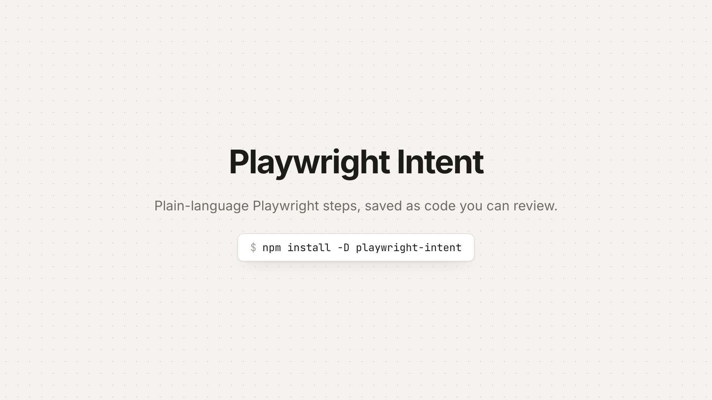

<h1 align="center">Playwright Intent</h1>

<p align="center">
	<strong>Plain-language Playwright steps, saved as code you can review.</strong>
</p>

<p align="center">
	<a href="https://www.npmjs.com/package/playwright-intent"></a>
	<a href="LICENSE"></a>
</p>

<p align="center">
	<picture>
		<source media="(prefers-color-scheme: dark)" srcset="docs/assets/animations/overview-dark.webp" />
		
	</picture>
</p>

---

Write Playwright steps in plain language. An agent turns each one into TypeScript once, and every later run replays that code like any other Playwright test.

```ts
import { test } from "playwright-intent";

test("checkout", async ({ page, ai }) => {
	await page.goto("/shop");
	await ai.do("add the cheapest shirt to the cart");
	await ai.do("check out as {email}", { email: "ada@example.com" });
});
```

## How it works

- **Intent:** the text you pass to `ai.do`. Use `{name}` for anything that varies, and pass the values as the second argument.
- **Step:** the TypeScript generated for an intent, saved as a file you can read and review. Changing an intent generates a new step.
- **Agent:** explores the live page and writes the step. It sees your test file and the page it's working on. Values you pass to `ai.do` aren't included in its instructions, but they can reach it through page content once they've been typed or displayed.
- **Store:** where steps live, and whether the agent may change them.

## Quick start

Requires Node 24 and Playwright 1.60 or later.

```bash
npm install -D playwright-intent
```

```ts
// playwright.config.ts
import {
	defineConfig,
	type IntentOptions,
	type IntentUseOptions,
} from "playwright-intent";
import { allow, fileStore, refuse } from "playwright-intent/file-store";

const intent = {
	model: "openai/gpt-6-luna",
	store: fileStore({ updates: { local: allow(), ci: refuse() } }),
} satisfies IntentOptions;

export default defineConfig<IntentUseOptions>({
	reporter: [["list"], ["playwright-intent/reporter", intent]],
	use: { intent },
});
```

Run your tests as usual, with `AI_GATEWAY_API_KEY` set or a provider's model in `model`. Then commit the new `.intent` folder.

## Documentation

- [Configuration](docs/configuration.md): the options in `playwright.config.ts`
- [Models](docs/models.md): choosing a model and provider
- [Stores and updates](docs/stores-and-updates.md): where steps live, regenerating them in CI and sharing them through a remote store
- [Prompts](docs/prompts.md): teaching the agent about your app
- [Editor support](docs/editor-support.md): the VS Code extension

## Project status

This is early, and the API may change. See [docs/design.md](docs/design.md) for how it works.

## Contributing

See [CONTRIBUTING.md](CONTRIBUTING.md) for development setup and releasing.

## License

[Apache-2.0](LICENSE).

Playwright is a trademark of its respective owner. This project is not affiliated with or endorsed by the Playwright project.

---

<p align="center">Built by</p>
<p align="center">
	<a href="https://endform.dev">
		<picture>
			<source media="(prefers-color-scheme: dark)" srcset="docs/assets/endform-logo-dark.svg" />
			
		</picture>
	</a>
</p>
